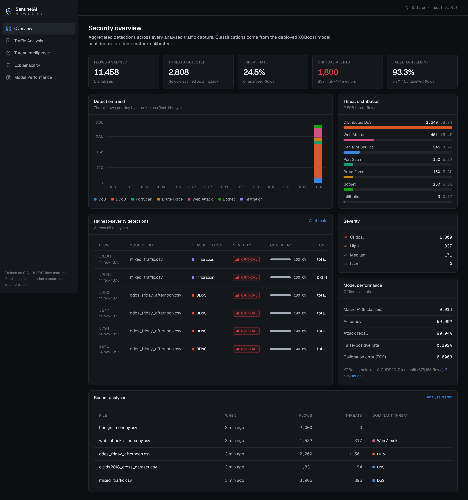
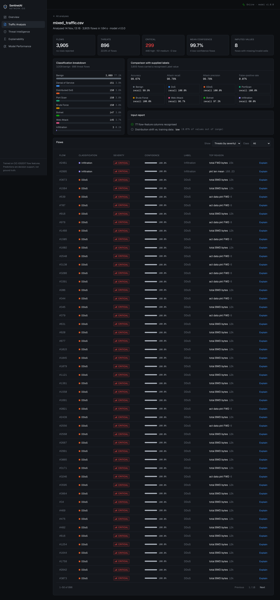
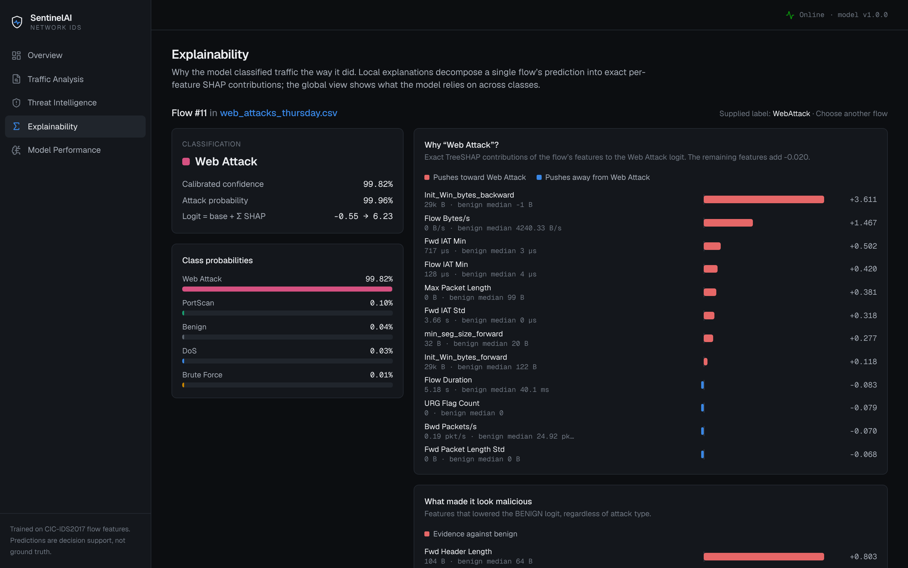
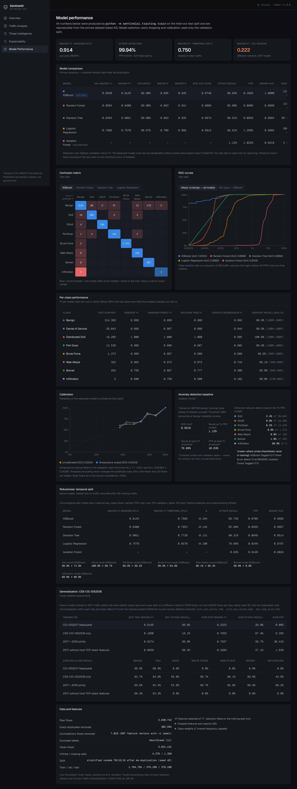
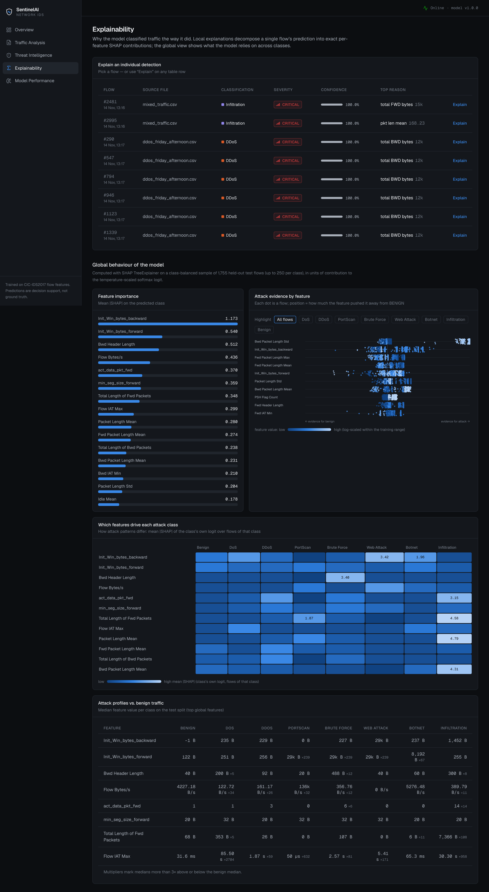

# SentinelAI — Explainable ML Network Intrusion Detection

SentinelAI classifies network flows from **CICFlowMeter** exports into benign
traffic and seven attack categories. It explains each decision with exact
**SHAP** values and serves the results through a **FastAPI** service and a
**Next.js** analyst console.

It is trained and evaluated on **CIC-IDS2017** with leakage controls
(de-duplication before splitting, train-only preprocessing, no identifier
features). It is also stress-tested on a time-ordered split and against
**CSE-CIC-IDS2018**. Those tests show where the model stops working, and this
README reports them alongside the headline numbers.



## Results at a glance

All numbers are measured on held-out data by the reproducible pipeline (see
[`docs/MODEL_CARD.md`](docs/MODEL_CARD.md) for everything, including per-class
confidence intervals).

| Evaluation | Deployed XGBoost |
|---|---|
| Stratified split, test (378,168 flows): macro-F1 / accuracy | **0.915** / 99.90% |
| Attack detection: recall / false-positive rate | **99.94%** / 0.102% (321 false alarms in 314,392 benign flows) |
| Calibration error (ECE) after temperature scaling | 0.0003 |
| **Temporal split** (tested on later traffic): macro-F1 | 0.751 — Bot recall falls to 0% |
| **Cross-dataset** (2017 model on CSE-CIC-IDS2018): macro-F1 | **0.222** — the model does not transfer |

Five models were compared on identical data:

| Model | Test macro-F1 | Attack recall | FPR | Size |
|---|---|---|---|---|
| Random Forest | **0.940** | 99.80% | 0.080% | 88 MB (pickle) |
| XGBoost *(deployed)* | 0.915 | **99.94%** | 0.102% | 3.4 MB |
| Decision Tree | 0.905 | 99.91% | 0.095% | 0.3 MB |
| Logistic Regression | 0.757 | 98.61% | 1.30% | 4 kB |
| Isolation Forest (unsupervised) | — | 1.1% at 1% FPR (AUC 0.92) | 1.02% | 6.8 MB |

Random Forest scores higher on macro-F1. The model card explains why XGBoost is
still the deployed model: the gap comes from Bot precision and a single
Infiltration flow out of five. XGBoost also loads without pickle and is 26×
smaller.

**What the experiments show**

- Headline random-split metrics on CIC-IDS2017 are optimistic. Testing on
  *later* traffic costs 0.15–0.16 macro-F1.
- A CIC-IDS2017 model misses most CSE-CIC-IDS2018 attacks of the same types.
  Training on both datasets covers both test sets, but it costs a **30%**
  false-positive rate on 2018 benign traffic. Adding a dataset widens coverage;
  it does not buy generalisation.
- Removing the dominant TCP-window features (a suspected dataset shortcut) does
  not improve transfer.
- On an attack never seen in training (Heartbleed), the supervised model flagged
  0/11 flows and the Isolation Forest flagged 11/11.

## Features

| Area | What you get |
|---|---|
| **Detection** | 8 classes: Benign, DoS, DDoS, PortScan, Brute Force, Web Attack, Botnet, Infiltration. Calibrated confidence; severity triage |
| **Traffic analysis** | Upload a CICFlowMeter CSV in CIC-IDS2017 *or* CSE-CIC-IDS2018 column naming, up to 25 MB / 100k flows. Per-file breakdown, ground-truth comparison when a `Label` column is present, input report, distribution-shift warning |
| **Threat intelligence** | Every suspicious flow across analyses, filterable by class, severity and confidence |
| **Explainability** | Per-flow SHAP waterfall ("why this class", "what made it look malicious"), global importance, class × feature heatmap, beeswarm, attack-vs-benign profiles |
| **Model performance** | Comparison table, confusion matrices, ROC curves (log FPR), per-class F1 with Wilson CIs, reliability diagram, temporal and cross-dataset experiments |
| **API** | REST + OpenAPI. JSON single/batch prediction, CSV upload, history, threats, stats, model card, feature schema |

| | |
|---|---|
|  |  |
|  |  |

## Quick start

### Docker (recommended)

```bash
git clone https://github.com/Harunamoh1/AI-Cybersecurity-Projects.git
```

```bash
cd AI-Cybersecurity-Projects/network-intrusion-detection
```

```bash
docker compose up --build
```

Open <http://localhost:3000>. Go to **Traffic Analysis** and click **Analyse**
on a bundled sample, or upload your own CSV. The trained model is committed, so
no training is needed to run the app.

To require an API key on the backend, set it before starting. The Next.js
server injects it, so the browser never sees it:

```bash
SENTINEL_API_KEY=$(openssl rand -hex 24) docker compose up --build
```

### Local development

Backend (Python 3.11+, tested on 3.13):

```bash
cd backend && python -m venv .venv && . .venv/bin/activate
```

```bash
pip install -r requirements-dev.txt
```

```bash
uvicorn sentinelai.api.main:app --reload
```

Swagger UI is at <http://localhost:8000/docs>.

Frontend (Node 22):

```bash
cd frontend && npm ci && npm run dev
```

The dev server proxies `/api/*` to `BACKEND_URL` (default
`http://localhost:8000`).

### Sample files

`backend/samples/` contains CSVs built only from **test-split** flows, in the
original CICFlowMeter layout with a `Label` column:

| File | Contents |
|---|---|
| `mixed_traffic.csv` | 3,905 flows covering every class |
| `ddos_friday_afternoon.csv` | DDoS flood with concurrent benign traffic |
| `web_attacks_thursday.csv` | Brute force, XSS and SQL injection |
| `benign_monday.csv` | Attack-free baseline (0 false alarms in our run) |
| `cicids2018_cross_dataset.csv` | 2018 traffic in 2018 naming — demonstrates the distribution-shift warning and the accuracy drop |

## Reproducing the evaluation

```bash
cd backend
```

```bash
python -m sentinelai.training.train --cross-dataset
```

```bash
python scripts/make_samples.py
```

The pipeline downloads CIC-IDS2017 (284 MB) and seven CSE-CIC-IDS2018 day files
(2.3 GB) from pinned URLs. It verifies their SHA-256 checksums and checks that
the CIC-IDS2017 label counts match the published counts. It then rewrites
`models/` (artifact, `metrics.json`, figures). A full run took 23.8 minutes on
4 CPU cores. Use `--sample 3000` for a smoke run in under a minute, or
`--skip-temporal` to skip the robustness protocol.

## Methodology in brief

1. **Data integrity.** The archive SHA-256 and all 15 published per-label
   counts (2,830,743 flows) are verified.
2. **Cleaning before splitting.**
   - 302,594 duplicate flows are removed. Without this step, identical flows
     would sit in train and test.
   - 7,018 flows whose feature vector appears with contradictory labels are
     removed.
   - Infinite and negative artefacts are imputed; the `-1` "not observed"
     sentinel is kept.
3. **Leakage controls.**
   - Identifiers (IP, port, flow id, timestamp) are never used as features.
   - `Destination Port` is excluded as a shortcut.
   - Feature selection (47 of 77 features: constant, duplicate and
     |ρ| ≥ 0.99 columns removed), imputation medians and class weights are
     fitted on the training split only.
   - The test split is used only for reporting.
4. **Imbalance.** √-inverse-frequency class weights. Small classes are reported
   with Wilson 95% intervals.
5. **Protocols.** A stratified split, a temporal split and cross-dataset tests
   (CSE-CIC-IDS2018), plus an ablation.
6. **Calibration.** Temperature scaling on validation. It never changes a
   prediction.
7. **Explainability.** Exact TreeSHAP for local and global explanations. A
   test asserts that SHAP values sum to the model's logit.

Details: [`docs/ARCHITECTURE.md`](docs/ARCHITECTURE.md) ·
[`docs/MODEL_CARD.md`](docs/MODEL_CARD.md).

## Security

- **Pickle-free, checksum-verified model loading.** No code runs when the model
  is loaded.
- **Upload limits.** Size is capped before multipart parsing. The upload must
  have a `.csv` extension and an allowed content type, contain no binary
  content, and stay within row and column caps. Cells are coerced to numbers
  and never evaluated.
- **No arbitrary file paths.**
  - Sample files are served from a whitelist built at startup.
  - Uploaded filenames are only used, sanitised, as display labels.
  - The proxy only forwards an allow-list of API routes.
- **Privacy by design.** IPs, ports, flow ids and timestamps are dropped before
  storage. The database file is created with mode 0600. Retention is bounded
  and history can be deleted.
- **Access and abuse controls.** An optional API key, compared in constant time
  and injected server-side. A per-client rate limit. Parameterised SQL.
  Security headers.
- **Containers.**
  - Processes run as non-root users on read-only root filesystems.
  - `cap_drop: ALL` and `no-new-privileges` are set, with memory and pid
    limits.
  - The backend is not published to the host.

## Testing

```bash
cd backend && ruff check . && pytest --cov
```

145 tests run, with 95% line coverage of the runtime package. They cover:

- feature canonicalisation and preprocessing
- cleaning, de-duplication and both split strategies
- zip-slip extraction
- metric correctness
- model integrity and tamper detection
- predictions on held-out flows
- SHAP additivity and SHAP ↔ XGBoost equivalence
- every API endpoint
- upload rejection cases: wrong extension, wrong content type, binary content,
  empty files, malformed CSV, size, row and column limits, formula cells
- missing and unexpected columns
- path traversal
- API-key enforcement and rate limiting
- retention, private DB permissions, and a check that IP addresses never reach
  the database

The frontend is linted, type-checked and built in CI
([workflow](../.github/workflows/network-intrusion-detection.yml)), which also
builds both Docker images.

## Project layout

```
network-intrusion-detection/
├── backend/
│   ├── sentinelai/
│   │   ├── schema.py            # canonical features (2017/2018 aliases), taxonomy
│   │   ├── features.py          # canonicalise, sanitise, select, impute (shared train/serve)
│   │   ├── data/                # sources (pinned + sha256), loading/cleaning, splitting
│   │   ├── training/            # models, train pipeline, evaluation, calibration, cross-dataset
│   │   ├── inference/detector.py# artifact loading, prediction, SHAP, shift detection
│   │   └── api/                 # FastAPI app, upload hardening, SQLite store, rate limit
│   ├── models/                  # committed artifact + metrics.json + figures
│   ├── samples/                 # held-out demo CSVs
│   ├── scripts/make_samples.py
│   └── tests/
├── frontend/                    # Next.js 16 · TypeScript · Tailwind 4 · Recharts
├── docs/                        # ARCHITECTURE.md, MODEL_CARD.md, screenshots
└── docker-compose.yml
```

## Limitations

- CIC-IDS2017 is emulated lab traffic with known labelling issues (Engelen et
  al., 2021; Lanvin et al., 2022). Do not expect the headline numbers on a real
  network; the temporal and cross-dataset results are the realistic picture.
- Infiltration has 5 test flows, so its metrics are statistically meaningless
  (recall 95% CI: 23–88%).
- The system analyses exported flow statistics; it does not capture packets or
  inspect payloads.

## Data and citation

- I. Sharafaldin, A. Habibi Lashkari, A. A. Ghorbani. *Toward Generating a New
  Intrusion Detection Dataset and Intrusion Traffic Characterization.* ICISSP
  2018.
- CSE-CIC-IDS2018 on AWS — Communications Security Establishment & Canadian
  Institute for Cybersecurity, <https://registry.opendata.aws/cse-cic-ids2018/>.

The sample CSVs are small extracts of these datasets, redistributed for
demonstration with attribution. Code is MIT-licensed (see the repository
[LICENSE](../LICENSE)).
