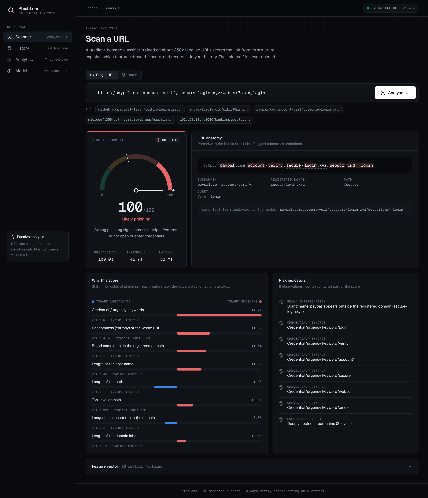
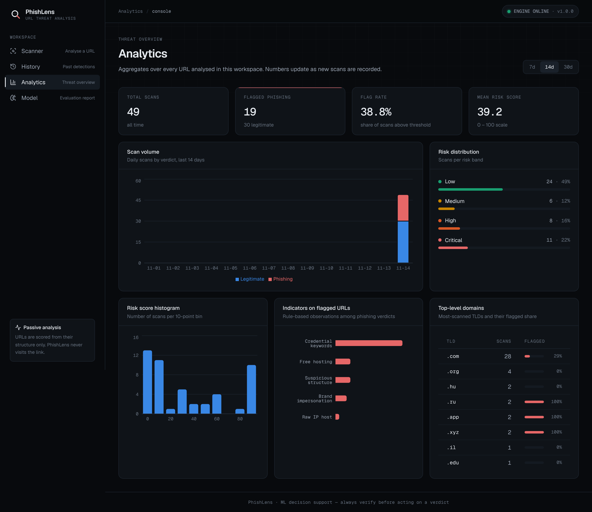
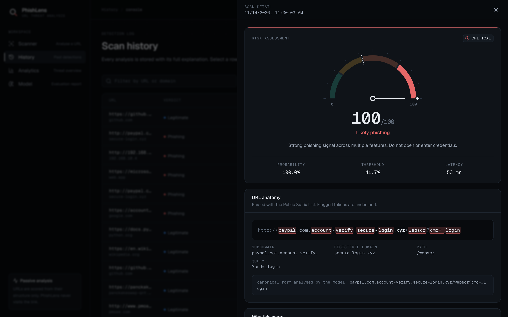
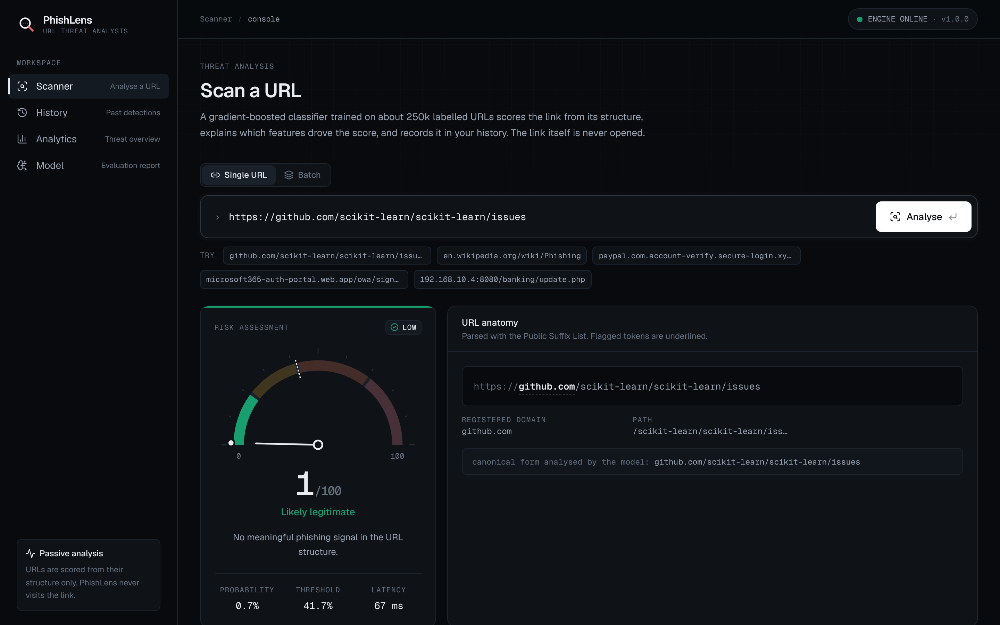
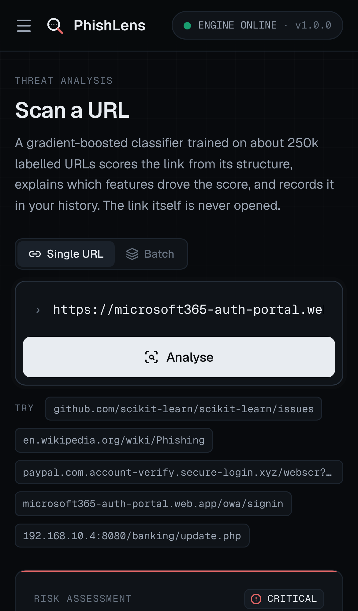
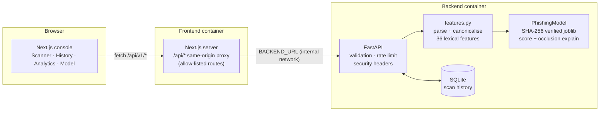
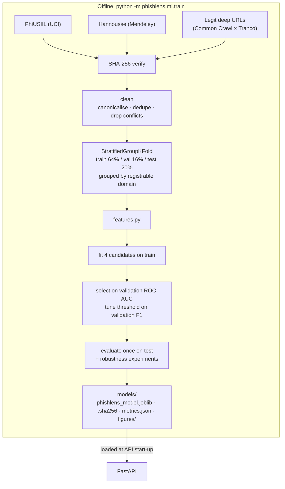
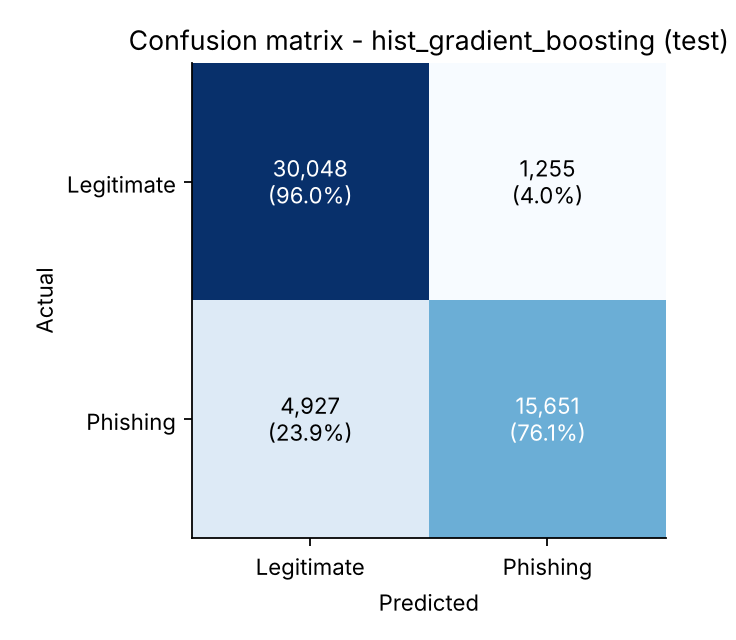
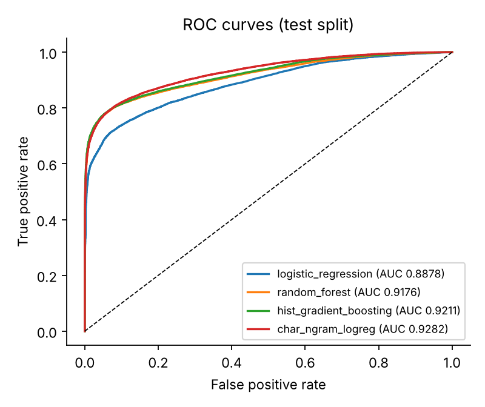
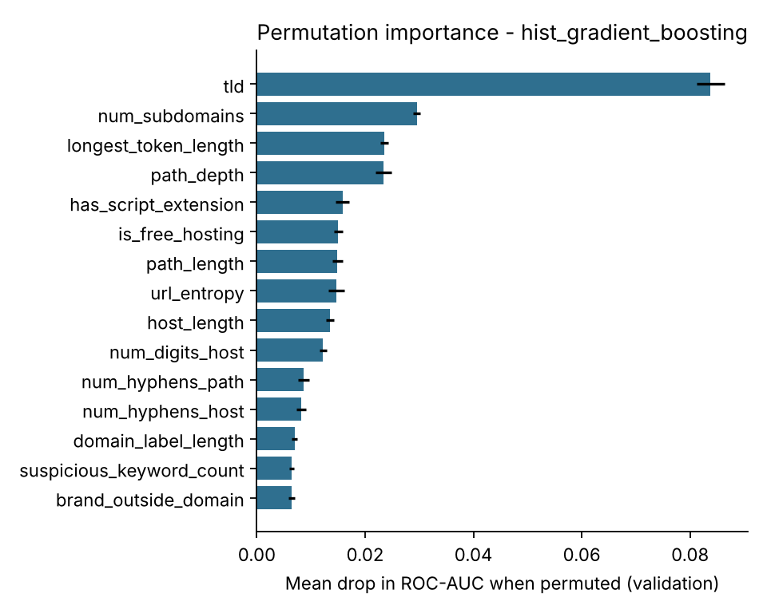

# PhishLens: Explainable ML Phishing URL Detection

PhishLens is a full-stack phishing URL detector. A gradient-boosted classifier, trained on about 260k labelled URLs, scores each link from its structure alone. The URL is never fetched. A FastAPI service returns the verdict, a risk score and a per-feature explanation, and a Next.js console shows scanning, history and analytics. It also includes the model's full evaluation report.



| | |
|---|---|
| **Model** | `HistGradientBoostingClassifier` on 36 lexical features, chosen over 3 other candidates |
| **Test set** | 51,881 URLs from 41,110 domains. No test domain appears in training. |
| **Test results** | Accuracy **88.0%**, precision **90.4%**, recall **78.0%**, F1 **83.7%**, ROC-AUC **0.921** |
| **Stack** | Python 3.13 · scikit-learn · pandas · FastAPI · Next.js 16 · TypeScript · Tailwind CSS 4 · Recharts · Docker |
| **Tests** | 110 pytest tests (unit and integration) · ESLint · `tsc --strict` · GitHub Actions CI |

> **Honest-metrics note.** The PhiUSIIL paper reports ~99.9% accuracy. That figure relies on features computed from the fetched web page and on a similarity index that leaks label information. PhishLens uses only the URL string, splits by domain, and removes presentation artefacts (see [Data leakage](#preventing-data-leakage)). The numbers above are what this harder, realistic setup actually achieves. They were computed by `phishlens/ml/train.py` and are stored in [`backend/models/metrics.json`](backend/models/metrics.json).

---

## Contents

1. [Features](#features)
2. [Architecture](#architecture)
3. [Quick start (Docker)](#quick-start-docker)
4. [Local development](#local-development)
5. [Machine-learning pipeline](#machine-learning-pipeline)
6. [Model evaluation](#model-evaluation)
7. [API reference](#api-reference)
8. [Testing](#testing)
9. [Limitations and false-positive risks](#limitations-and-false-positive-risks)
10. [Security considerations](#security-considerations)
11. [Datasets and licenses](#datasets-and-licenses)
12. [Project structure](#project-structure)

---

## Features

- **URL scanning.** Analyse one URL or a batch of up to 100. Input is validated: only `http`/`https` schemes are accepted, and the parser rejects `javascript:`, `data:`, control characters and invalid ports.
- **Risk scoring.** The model outputs a phishing probability, and a decision threshold tuned on validation data turns it into a verdict. Four risk bands (low, medium, high, critical) are anchored on that threshold.
- **Explainability.**
  - *Model-based:* an occlusion explanation in log-odds space shows which features pushed a given URL towards or away from phishing.
  - *Rule-based indicators:* brand impersonation, look-alike domain, `@` obfuscation, raw IP, free hosting and similar. These are shown as context and do not affect the score.
  - *URL anatomy:* the URL is split into subdomain, registered domain, path and query using the Public Suffix List, with flagged tokens underlined.
- **Detection history.** Scans are stored in SQLite. You can search, filter and paginate them, open a detail drawer with the full explanation, and delete entries.
- **Analytics dashboard.** Volume over time, risk distribution, score histogram, top indicators and top TLDs.
- **Model card page.** Shows metrics, confusion matrix, ROC curve, model comparison, robustness experiments, permutation importance, datasets and limitations. All of it is served live from the training report.
- **Responsive.** Verified at 1440px desktop and iPhone 14 widths with no horizontal overflow.

<table>
<tr><td></td><td></td></tr>
<tr><td align="center">Analytics</td><td align="center">History and scan detail</td></tr>
<tr><td></td><td></td></tr>
<tr><td align="center">Legitimate result</td><td align="center">Mobile</td></tr>
</table>

The full model report page: [`docs/screenshots/model.png`](docs/screenshots/model.png).

---

## Architecture



The same `features.py` module is used both for training and for serving, so the features the model was trained on and the features it sees in production cannot drift apart:



**Design decisions**

| Decision | Why |
|---|---|
| Lexical features only, no fetching | Scanning a link must not touch attacker infrastructure, and it keeps latency to milliseconds. |
| Gradient boosting over the char-n-gram model | Nearly the same AUC (0.921 vs 0.928) with features a person can explain. The opaque model is reported for comparison only. |
| Same-origin proxy in Next.js | The browser never talks to the backend directly, so no permissive CORS is needed and the backend is not published in Docker. |
| SQLite | No extra infrastructure for a single-node app. All queries are parameterised. |
| Model checksum verification | `joblib` files run code when loaded. The API refuses to load a model whose SHA-256 does not match the one recorded by the training run. |

---

## Quick start (Docker)

Requirements: Docker with Compose v2.

```bash
git clone https://github.com/harunamoh1/AI-Cybersecurity-Projects.git
```

```bash
cd AI-Cybersecurity-Projects/phishing-detection
```

```bash
docker compose up --build
```

Open **http://localhost:3000**. The trained model is committed to the repo, so no training step is needed to run the app.

- Scan history is kept in the `scan-history` named volume.
- The backend is only reachable on the internal Compose network. To use the API or Swagger UI directly, uncomment the `ports` block in `docker-compose.yml` and open http://localhost:8000/docs.
- The backend runs as a non-root user with a read-only root filesystem and `no-new-privileges`, and both containers have health checks.

---

## Local development

### Backend

```bash
cd phishing-detection/backend
```

```bash
python -m venv .venv && source .venv/bin/activate
```

```bash
pip install -r requirements-dev.txt
```

```bash
uvicorn phishlens.api.main:app --reload --port 8000
```

Interactive API docs are at http://localhost:8000/docs.

| Variable | Default | Purpose |
|---|---|---|
| `PHISHLENS_MODEL_DIR` | `backend/models` | Location of the model artifact |
| `PHISHLENS_DB_PATH` | `backend/phishlens.db` | SQLite file (`:memory:` for ephemeral) |
| `PHISHLENS_CORS_ORIGINS` | `http://localhost:3000` | Comma-separated allowed origins |
| `PHISHLENS_RATE_LIMIT` | `120` | Requests per minute per client IP (0 = off) |
| `PHISHLENS_MAX_BATCH` | `100` | Max URLs per batch request |
| `PHISHLENS_MAX_URL_LENGTH` | `2048` | Max URL length |
| `PHISHLENS_VERIFY_CHECKSUM` | `true` | Verify the model SHA-256 before loading |

No API keys or credentials are needed anywhere in the project.

### Frontend

```bash
cd phishing-detection/frontend
```

```bash
npm ci
```

```bash
BACKEND_URL=http://localhost:8000 npm run dev
```

Open http://localhost:3000.

### Retraining the model

```bash
cd phishing-detection/backend
```

```bash
python -m phishlens.ml.train --data-dir data --out-dir models
```

This downloads the two public datasets into `data/` (git-ignored) and checks their SHA-256 hashes. It then trains, evaluates and writes the model, checksum, `metrics.json` and figures. It takes about 3 minutes on 4 CPU cores. All randomness is seeded (`random_state=42`), so the split is deterministic and reruns on the same library versions should reproduce the model.

To rebuild the legitimate deep-URL corpus (optional, because the result is committed):

```bash
python scripts/build_legit_corpus.py
```

---

## Machine-learning pipeline

### 1. Data

| Source | Rows used | Labels | Notes |
|---|---|---|---|
| PhiUSIIL Phishing URL Dataset (UCI #967) | 235,795 | 134,850 legit / 100,945 phishing | Only `URL` and `label` are used. Every legitimate URL is a bare `https://www.<domain>`. |
| Hannousse & Yahiouche (Mendeley) | 11,430 | balanced | Legitimate URLs include realistic paths. |
| Legitimate deep URLs (built here) | 16,165 | legitimate | Crawled page URLs from 1,790 popular domains. Tranco list `Y897G` combined with the Common Crawl `CC-MAIN-2026-39` index. |

**Why the third corpus exists.** The first model trained on the two public datasets learned that *any URL with a path is phishing*. On the test split, it flagged **45.7%** of ordinary legitimate deep links: GitHub repositories, documentation pages, news articles. `scripts/build_legit_corpus.py` adds real crawled URLs from popular domains, excluding shorteners and free-hosting platforms. With it, that false-positive rate falls to **14.0%**. The comparison is in [Model evaluation](#model-evaluation).

### 2. Cleaning

From [`metrics.json`](backend/models/metrics.json):

- Raw rows: 263,390
- Unparseable rows removed: 1
- Rows whose canonical URL had contradicting labels, removed: 86
- Canonical duplicates removed: 3,904
- Clean rows: **259,399** (102,889 phishing / 156,510 legitimate)

### 3. Feature extraction

[`backend/phishlens/features.py`](backend/phishlens/features.py) computes 35 numeric features plus 1 categorical feature:

- **Structure:** URL, host, path and query lengths; dots, hyphens and digits in the host; subdomain depth; path depth; query-parameter count; longest token; longest repeated-character run.
- **Randomness:** Shannon entropy of the domain label and of the whole URL; longest consonant run; digit ratio.
- **Obfuscation:** `@` / userinfo, `//` inside the path, percent-encoding, punycode (`xn--`), an embedded `http` token, raw IP host (including integer-encoded IPv4), non-standard port.
- **Semantic signals:** credential/urgency keywords (matched on token boundaries so `/author/` does not count as `auth`), brand name outside the registered domain, brand look-alike domain, URL shortener, free/instant hosting platform, executable or archive download, server-side script extension.
- **TLD:** target-encoded inside the pipeline with cross-fitting.

### 4. Model selection

Four candidates were trained on the same training split with source-balanced sample weights:

- Logistic regression (scaled features)
- Random forest
- Histogram gradient boosting
- Character 3–5-gram TF-IDF + logistic regression (opaque reference)

Selection used validation ROC-AUC among the explainable models. The decision threshold (0.417) is the value that maximises F1 on the validation split. The test split was used only for the final evaluation.

### Preventing data leakage

| Risk | Mitigation |
|---|---|
| The same site appears in train and test (campaigns reuse domains) | `StratifiedGroupKFold` grouped by registrable domain, PSL-aware so each `*.firebaseapp.com` tenant is its own group. The pipeline asserts zero overlap, and a unit test checks it. |
| Trivial URL variants on both sides of the split | Deduplication on the canonical URL. Contradicting labels are dropped. |
| Dataset artefacts that encode the label (PhiUSIIL legitimate URLs always have `https`, `www.` and no trailing slash, and the dataset is lower-cased) | Canonicalisation: scheme, `www.`, fragment and a bare trailing `/` are removed, and everything is lower-cased. The scheme is deliberately not a feature. |
| Pre-computed columns derived from page content or from the legitimate set (`URLSimilarityIndex`, HTML features) | Ignored. Only the raw URL string is used. |
| Target-encoding leakage for the TLD | `TargetEncoder` with internal 5-fold cross-fitting, fitted on training data only, inside the pipeline. |
| Tuning on test data | Model choice and threshold use validation only. Test is scored once. |

---

## Model evaluation

All numbers below come from [`backend/models/metrics.json`](backend/models/metrics.json), generated by the training run. Test split: 51,881 URLs from 41,110 domains.

### Deployed model at the tuned threshold (0.417)

| Accuracy | Precision | Recall | F1 | ROC-AUC | PR-AUC | Brier |
|---|---|---|---|---|---|---|
| 0.8798 | 0.9037 | 0.7800 | 0.8373 | 0.9211 | 0.9203 | 0.0922 |

**Confusion matrix (test):**

| | Predicted legitimate | Predicted phishing |
|---|---|---|
| **Actual legitimate** | 29,593 (TN) | 1,710 (FP) |
| **Actual phishing** | 4,527 (FN) | 16,051 (TP) |

- False-positive rate: 5.46%
- False-negative rate: 22.0%

 

### Model comparison (test split, threshold 0.5)

| Model | Accuracy | Precision | Recall | F1 | ROC-AUC |
|---|---|---|---|---|---|
| Logistic regression | 0.8391 | 0.9146 | 0.6556 | 0.7638 | 0.8878 |
| Random forest | 0.8805 | 0.9228 | 0.7625 | 0.8350 | 0.9176 |
| **Histogram gradient boosting (deployed)** | **0.8808** | **0.9258** | **0.7606** | **0.8351** | **0.9211** |
| Char n-gram TF-IDF + LogReg (opaque reference) | 0.8790 | 0.9109 | 0.7703 | 0.8347 | 0.9282 |

### Robustness

| Slice / experiment | Accuracy | Precision | Recall | F1 | ROC-AUC | FPR |
|---|---|---|---|---|---|---|
| Test slice: PhiUSIIL | 0.8835 | 0.9364 | 0.7749 | 0.8480 | 0.9192 | 3.8% |
| Test slice: Hannousse | 0.8309 | 0.8046 | 0.8709 | 0.8364 | 0.9159 | 20.9% |
| Test slice: legitimate deep URLs | 0.8599 | n/a | n/a | n/a | n/a | 14.0% |
| Ablation: no source-balanced weights | 0.8821 | 0.9044 | 0.7857 | 0.8409 | 0.9246 | 5.5% (19.3% on deep URLs) |
| Ablation: no legitimate deep-URL corpus | 0.8661 | 0.8612 | 0.7897 | 0.8239 | 0.9136 | 8.4% (**45.7%** on deep URLs) |
| Cross-dataset: train PhiUSIIL → test Hannousse | 0.6332 | 0.5775 | 0.9725 | 0.7247 | 0.6818 | 70.1% |
| Cross-dataset: train Hannousse → test PhiUSIIL | 0.8382 | 0.9441 | 0.6530 | 0.7720 | 0.8722 | 2.8% |

**What this shows**

1. Single-dataset benchmarks badly overstate real-world performance. A model trained only on PhiUSIIL falls to ROC-AUC 0.68 on another dataset and flags 70% of its legitimate URLs.
2. The added legitimate corpus cuts false positives on ordinary deep links by more than 3×.
3. Overall, source-balanced weighting is a trade-off rather than a clear win. It gives slightly lower aggregate F1 but fewer false positives on deep links (14.0% vs 19.3%), and false positives are what users notice. It was kept for that reason.

### Global feature importance

Permutation importance (drop in validation ROC-AUC, top 6):

| Feature | Importance |
|---|---|
| `tld` | 0.084 |
| `num_subdomains` | 0.030 |
| `longest_token_length` | 0.023 |
| `path_depth` | 0.023 |
| `has_script_extension` | 0.016 |
| `is_free_hosting` | 0.015 |



The [model card](docs/MODEL_CARD.md) covers intended use, data provenance, and evaluation caveats in more detail.

---

## API reference

Base URL: `http://localhost:8000`. OpenAPI/Swagger docs are at `/docs`. All bodies are JSON.

| Method | Path | Description |
|---|---|---|
| `GET` | `/health` | Liveness check and model identity |
| `POST` | `/api/v1/scan` | Analyse one URL |
| `POST` | `/api/v1/scan/batch` | Analyse up to 100 URLs (per-item errors) |
| `GET` | `/api/v1/history?limit&offset&verdict&q` | Paginated scan history |
| `GET` | `/api/v1/history/{id}` | Full stored result |
| `DELETE` | `/api/v1/history/{id}` | Delete one scan |
| `DELETE` | `/api/v1/history` | Clear history |
| `GET` | `/api/v1/stats?days=14` | Dashboard aggregates |
| `GET` | `/api/v1/model` | Model card and evaluation report |

### `POST /api/v1/scan`

```bash
curl -s -X POST http://localhost:8000/api/v1/scan -H 'content-type: application/json' -d '{"url": "http://paypal.com.account-verify.secure-login.xyz/webscr?cmd=_login"}'
```

Response (abridged; actual values from the deployed model):

```json
{
  "id": "6f1c…",
  "url": "http://paypal.com.account-verify.secure-login.xyz/webscr?cmd=_login",
  "canonical_url": "paypal.com.account-verify.secure-login.xyz/webscr?cmd=_login",
  "verdict": "phishing",
  "risk_score": 100.0,
  "risk_level": "critical",
  "probability": 0.999988,
  "threshold": 0.4172,
  "components": { "subdomain": "paypal.com.account-verify", "registered_domain": "secure-login.xyz", "path": "/webscr", "query": "cmd=_login", "...": "..." },
  "contributions": [
    { "feature": "suspicious_keyword_count", "description": "Credential / urgency keywords", "value": 6, "reference": 0, "impact": 4.71 },
    { "feature": "brand_outside_domain", "description": "Brand name outside the registered domain", "value": 1, "reference": 0, "impact": 1.64 }
  ],
  "indicators": [
    { "token": "paypal", "kind": "brand", "reason": "Brand name 'paypal' appears outside the registered domain (secure-login.xyz)" }
  ],
  "features": { "url_length": 60, "...": "..." },
  "model": { "name": "hist_gradient_boosting", "version": "1.0.0" },
  "latency_ms": 20.8
}
```

- `impact` is the shift in **log-odds** of phishing when that feature is reset to its median value on legitimate training URLs. Positive values push towards phishing.
- `risk_level` bands, with `t` = threshold:
  - low: `p < t/2`
  - medium: `t/2 ≤ p < t`
  - high: `t ≤ p < t + (1−t)/2`
  - critical: above that

### Errors

| Status | When | Body |
|---|---|---|
| `400` | Unsupported scheme, malformed host/port, batch too large | `{"detail": "Unsupported scheme 'javascript'; only http and https are analysed"}` |
| `404` | Unknown scan id | `{"detail": "Scan not found"}` |
| `422` | Schema violation: missing or blank `url`, wrong type, over 2048 chars, bad query param | `{"detail": "url: String should have at most 2048 characters"}` |
| `429` | Rate limit exceeded | `{"detail": "Rate limit exceeded; try again in a minute"}` |

---

## Testing

```bash
cd phishing-detection/backend && pytest --cov
```

```bash
cd phishing-detection/frontend && npm run lint && npm run typecheck && npm run build
```

The 110 backend tests cover:

- **Features:** canonicalisation, PSL parsing, every obfuscation signal, keyword token boundaries, brand detection on official vs look-alike domains, 14 malformed-input cases, and a check that the scheme cannot change the features.
- **Data:** canonical deduplication, conflicting-label removal, zero domain overlap across splits, split reproducibility, and weighting maths.
- **Model:**
  - risk-band boundaries
  - tampered or missing checksum is refused
  - explanation structure, determinism
  - clear-cut legitimate and phishing examples (behavioural sanity checks, kept separate from the reported metrics)
- **API (integration, real model):**
  - scans and validation errors (400/422)
  - batch with mixed valid and invalid items
  - history pagination, filtering and search, including SQL-wildcard and injection strings
  - delete and clear, stats, model card
  - rate limiting, security headers, OpenAPI
- **Model card consistency:** reported accuracy, precision and recall are recomputed from the stored confusion matrix.

CI ([`.github/workflows/phishing-detection.yml`](../.github/workflows/phishing-detection.yml)) runs ruff, the model checksum check, pytest with coverage, ESLint, type-checking, the Next.js build and `docker compose build`.

---

## Limitations and false-positive risks

PhishLens is decision support, not an oracle.

- **Lexical-only blind spots.** Phishing pages on compromised legitimate sites (`https://small-bakery.com/wp-content/x/`) or on clean-looking newly registered domains can score low. The page content, certificate, WHOIS age and reputation are not used.
- **Login pages of real brands.** The model has no domain-reputation signal, so legitimate authentication URLs can look like phishing. Observed on the live model:
  - `https://accounts.google.com/signin/v2/identifier` scores **0.60**: false positive.
  - `https://www.paypal.com/signin` scores **0.44**, just above the 0.417 threshold: false positive.
  - `https://news.ycombinator.com/item?id=123456` scores **0.61**: false positive (short numeric query on a domain with few path segments).

  A production deployment should combine the model with an allow-list or a reputation feed. That feed should *not* be added as a training feature: the legitimate corpus was sampled from a top-sites list, so the feature would leak the label.
- **False-positive rates by URL type (test split):**
  - bare-domain legitimate sites: 3.8%
  - Hannousse legitimate URLs: 20.9%
  - crawled legitimate deep URLs: 14.0%

  Long random tokens, many subdomains, uncommon TLDs and free hosting platforms all raise the score.
- **Recall gap.** 22% of phishing URLs in the test split are missed. Many are bare domains with no path (e.g. `maria.susypro.com`), which give a lexical model little to work with.
- **URL shorteners** (`bit.ly/...`) score near 1.0 because shortened links are heavily phishing-skewed in the data. The real destination is unknown without expanding the link, which PhishLens deliberately does not do.
- **Distribution shift.** The data is a 2019–2026 snapshot, and the cross-dataset experiments show how fragile URL models are outside their training distribution. Retrain periodically on fresh feeds.
- **Label noise.** The legitimate corpus assumes that crawled pages on top-50k domains are benign. A small number may be compromised.
- **Explanations** measure one feature at a time. Correlated features (e.g. `url_length` and `path_length`) can share or hide credit.

---

## Security considerations

- URLs are **never fetched**, so there is no SSRF surface and no contact with attacker infrastructure.
- Strict input validation:
  - scheme allow-list
  - length cap
  - control-character and whitespace rejection
  - port and host validation
- All SQL is parameterised, and LIKE wildcards are escaped.
- The model artifact is integrity-checked (SHA-256) before `joblib.load`.
- The API sets security headers (`nosniff`, `DENY` framing, `no-referrer`, `no-store`) and has a per-IP rate limiter. CORS is a configurable allow-list.
- The frontend proxy only forwards allow-listed API routes.
- Containers:
  - run as non-root
  - backend has a read-only root filesystem
  - `no-new-privileges`
  - the backend port is not published
- No secrets: the project needs no API keys. `.env` files are git-ignored.

---

## Datasets and licenses

| Dataset | License | Citation |
|---|---|---|
| PhiUSIIL Phishing URL Dataset | CC BY 4.0 | Prasad, A. & Chandra, S. (2024). *PhiUSIIL: A diverse security profile empowered phishing URL detection framework based on similarity index and incremental learning.* Computers & Security 136. [doi:10.24432/C5C051](https://doi.org/10.24432/C5C051) |
| Web page phishing detection dataset | CC BY 4.0 | Hannousse, A. & Yahiouche, S. (2021). *Towards benchmark datasets for machine learning based website phishing detection.* EAAI 104. [doi:10.17632/c2gw7fy2j4.3](https://doi.org/10.17632/c2gw7fy2j4.3) |
| Tranco top-sites list `Y897G` | Free for research, with citation | Le Pochat et al. (2019). *Tranco: A Research-Oriented Top Sites Ranking Hardened Against Manipulation.* NDSS. |
| Common Crawl `CC-MAIN-2026-39` URL index | [Common Crawl Terms of Use](https://commoncrawl.org/terms-of-use) | |

**Other public datasets considered and not used:**

- UCI *Phishing Websites* (2015): only pre-computed features, no raw URLs.
- ISCX-URL-2016: registration-gated, with redistribution terms.
- Kaggle *Malicious URLs*: requires an account, and its sources are mixed with unclear licensing.
- PhishTank and OpenPhish: live feeds whose terms restrict redistribution. They are good for future fresh-data retraining.

The raw public datasets are downloaded at training time and are not redistributed in this repository. Only the derived list of legitimate URLs (`backend/datasets/legit_deep_urls.csv`) is committed.

---

## Project structure

```
phishing-detection/
├── backend/
│   ├── phishlens/
│   │   ├── features.py          # URL parsing, canonicalisation, 36 features, indicators
│   │   ├── ml/
│   │   │   ├── data.py          # download + verify, clean, grouped split, weights
│   │   │   ├── train.py         # train / select / evaluate / experiments / persist
│   │   │   └── model.py         # load (checksum), score, occlusion explanation
│   │   └── api/
│   │       ├── main.py          # FastAPI app factory and routes
│   │       ├── schemas.py       # Pydantic request/response models
│   │       ├── storage.py       # SQLite history + analytics
│   │       ├── ratelimit.py     # sliding-window limiter
│   │       └── config.py        # env-based settings
│   ├── scripts/build_legit_corpus.py
│   ├── datasets/legit_deep_urls.csv
│   ├── models/                  # model, checksum, metrics.json, figures/
│   ├── tests/                   # 110 pytest tests
│   └── Dockerfile
├── frontend/
│   ├── src/app/                 # / (scanner), /history, /analytics, /model, /api proxy
│   ├── src/components/          # RiskGauge, UrlAnatomy, Contributions, Shell, ui
│   ├── src/lib/                 # typed API client, formatters
│   └── Dockerfile
├── docs/
│   ├── MODEL_CARD.md
│   └── screenshots/
└── docker-compose.yml
```

## License

MIT. See [LICENSE](../LICENSE). Dataset licenses are listed above.
